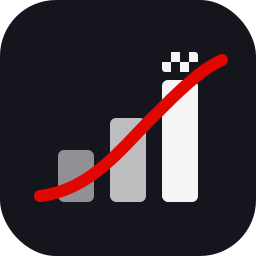
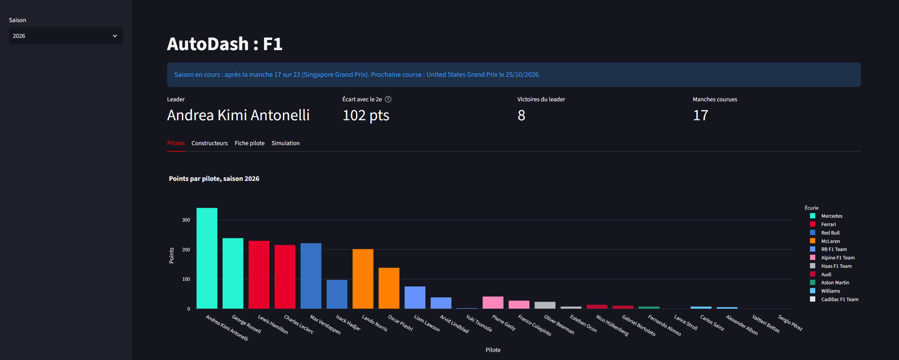

# AutoDash




Tableau de bord des statistiques du sport automobile, par saison et par course, avec simulation des dernières manches d'un championnat encore ouvert.

> Statut : en développement. Pour l'instant, seule la Formule 1 est couverte. MotoGP, WRC, Formule E et WEC sont prévus.



## Fonctionnalités

- Sélecteur de saison, de 1950 à la saison en cours
- Suivi de la saison en cours : dernière manche courue et prochaine course
- Chiffres clés en haut de page : leader (ou champion), écart avec le 2e, victoires et manches courues
- Classement pilotes officiel, avec l'écurie actuelle du pilote
- Classement constructeurs : les points de chaque course vont à l'écurie pour laquelle le pilote roulait ce jour-là
- Fiche pilote : évolution des points course par course et statistiques (victoires, podiums, abandons...)
- Simulation : points encore en jeu et pilotes pouvant encore être champions
- Scénario « Et si... ? » : choix du résultat des prétendants sur chaque course restante (position, DNF, DNS ou DSQ) et calcul du classement final
- Courses sprint incluses
- Thème sombre aux couleurs de la F1 et couleurs des écuries
- Mise en cache des appels API (1 heure) pour accélérer l'affichage et limiter la charge sur l'API

## Stack

Python 3.10+, Streamlit, Plotly, pandas, requests, pytest.
Données : [API Jolpica-F1](https://api.jolpi.ca/) (successeur d'Ergast).

## Installation

### Linux / macOS

Testé sur Ubuntu 22.04.

```bash
git clone https://github.com/Nixy00/AutoDash.git
cd AutoDash
python3 -m venv venv
source venv/bin/activate
pip install -r requirements.txt
python3 -m streamlit run app.py
```

### Windows (PowerShell)

```powershell
git clone https://github.com/Nixy00/AutoDash.git
cd AutoDash
py -m venv venv
.\venv\Scripts\Activate.ps1
pip install -r requirements.txt
py -m streamlit run app.py
```

L'application est ensuite disponible sur http://localhost:8501.

## Tests

Les calculs sont couverts par des tests automatisés, écrits sur de petites données inventées. Ils sont lancés automatiquement par GitHub Actions à chaque push, sur Python 3.10 et 3.13.

```bash
pip install -r requirements-dev.txt
python3 -m pytest -v
```

Ils vérifient notamment les règles de calcul décrites plus bas : un sprint gagné n'est pas une victoire, les points constructeurs vont à l'écurie du jour, un pilote à un tour n'a pas abandonné, et les saisies invalides sont refusées.

## Structure du projet

```
AutoDash/
├── app.py                  # interface Streamlit
├── requirements.txt        # dépendances de l'application
├── requirements-dev.txt    # dépendances de développement (pytest)
├── .streamlit/
│   └── config.toml         # thème sombre du dashboard
├── .github/workflows/
│   └── tests.yml           # tests automatiques (GitHub Actions)
├── assets/                 # logo (SVG et PNG)
├── docs/                   # capture d'écran du README
├── src/
│   ├── ingestion/
│   │   └── f1_api.py       # récupération des données (API, pagination)
│   ├── analysis/
│   │   ├── standings.py    # classements et statistiques
│   │   └── simulation.py   # simulation de fin de championnat
│   └── dashboard/
│       └── theme.py        # couleurs des écuries et libellés
└── tests/                  # tests automatisés (pytest)
```

Principe : `ingestion` récupère, `analysis` calcule, `app.py` affiche.
Aucun de ces modules n'est mélangé avec les autres.

Le code (variables, fonctions, commits) est écrit en anglais, l'interface est en français.

## Choix de calcul

- **Classement pilotes** : position, points et victoires officiels de l'API. L'écurie affichée est celle de la dernière manche du pilote.
- **Avant 1991** : seuls les meilleurs résultats de chaque pilote comptaient pour le titre. Le classement utilise donc les points officiels, qui intègrent ces résultats retirés (par exemple Senna champion 1988 avec 90 points, devant Prost avec 87, alors que Prost en avait marqué 105 au total). La fiche pilote, elle, affiche tous les points marqués en piste.
- **Classement constructeurs** : chaque résultat rapporte ses points à l'écurie pour laquelle le pilote roulait ce jour-là. Un pilote qui change d'équipe en cours d'année répartit donc ses points entre les deux.
- **Avant 1958** : pas de championnat constructeurs, l'onglet est désactivé.
- **Années 1950** : des pilotes partageaient parfois une voiture et les points étaient répartis, donc les totaux constructeurs sont moins fiables.
- **Abandons** : un pilote est compté comme ayant abandonné s'il n'a ni terminé (même avec des tours de retard), ni été disqualifié, ni été non partant.
- **Simulation** : barème actuel (25 points pour une victoire, 8 pour un sprint, pas de point de meilleur tour). Un pilote reste en course pour le titre tant que ses points plus le maximum restant atteignent au moins les points du leader. Disponible uniquement pour la saison en cours.
- **Scénario « Et si... ? »** : l'utilisateur fixe le résultat des pilotes choisis sur les courses restantes (position, DNF, DNS ou DSQ). DNF, DNS et DSQ ne rapportent aucun point. Les autres pilotes ne marquent plus de points, et les égalités ne sont pas départagées.
- **Données anciennes** : certains champs peuvent être absents, le code les gère sans planter.

## Vérification

Les totaux du classement constructeurs, calculés course par course (sprints inclus), ont été comparés à ceux de l'endpoint officiel `/constructorstandings/` de l'API Jolpica pour les saisons 2025, 2010 et 1990. Les résultats concordent.

Le cas des résultats retirés a été vérifié sur la saison 1988 (Senna champion devant Prost).

Pour refaire la vérification : ouvrir `https://api.jolpi.ca/ergast/f1/<saison>/constructorstandings/` et comparer avec l'onglet « Constructeurs » du dashboard.

## Feuille de route

- [x] Fiche pilote (évolution des points course par course)
- [x] Gestion de la saison en cours
- [x] Simulation : pilotes pouvant encore être champions
- [x] Simulation : hypothèses de l'utilisateur sur les courses restantes
- [x] Tests automatisés et intégration continue (GitHub Actions)
- [x] Finitions visuelles : thème sombre, logo, chiffres clés
- [ ] Docker et docker-compose
- [ ] Simulation aléatoire : probabilité de titre de chaque pilote
- [ ] Détail des abandons dans la fiche pilote (manche, Grand Prix, cause)
- [ ] Stockage en base PostgreSQL
- [ ] Autres disciplines : MotoGP, WRC, Formule E, WEC
- [ ] Version React + FastAPI

## Sécurité

- Validation de la saison avant tout appel API
- Validation des saisies du scénario (positions limitées à une liste, doublons détectés)
- Timeout sur les requêtes HTTP
- Droits minimaux pour GitHub Actions (lecture seule du code)
- Aucun secret dans le dépôt (`.env` ignoré par Git)

## Licence et données

Projet personnel réalisé pour mon portfolio. Les données appartiennent à leurs sources respectives.